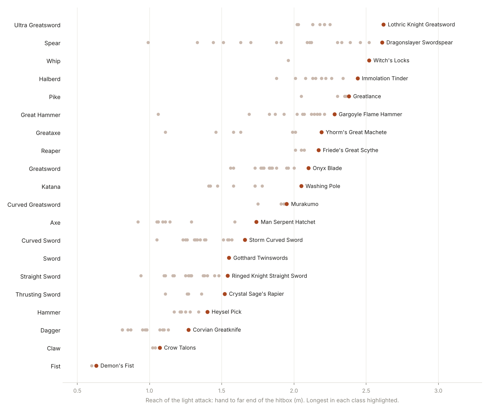

# Dark Souls III: light-attack DPS for every weapon, from game data

Sustained light-attack DPS for every melee weapon and infusion in Dark Souls III, computed from the game's own
animation timing (TAE) and weapon parameters, with the stat spread that maximises it.

Existing community frame data covers a handful of reference weapons per class, measured from video or from an
early regulation. This set reads the attack and cancel frames for every weapon moveset straight out of
`c0000.anibnd.dcx`, including paired weapons, fists, claws, whips, reapers and DLC weapons.

**Interactive calculator:** [heyobi.github.io/ds3-frame-dps](https://heyobi.github.io/ds3-frame-dps/) (enter your own stats or soul level, weapon upgrade level and target defense; click a weapon for a leveling path with a DPS chart).

**Elden Ring:** moved to its own repo, [heyobi/er-frame-dps](https://github.com/heyobi/er-frame-dps) (calculator: [heyobi.github.io/er-frame-dps](https://heyobi.github.io/er-frame-dps/)).

**Game version:** App ver. 1.15.2, Regulation ver. 1.35, Ashes of Ariandel + The Ringed City (Steam, PC)

## Headline result

Against a flat 120 defense, SL120, +10 / +5 weapons, no buffs, no bleed:

| # | Weapon (wiki) | Infusion | Move | s / attack | DPS def 80 | DPS def 120 | DPS def 160 | Str/Dex/Int/Fth/Lck |
|---|---|---|---|---|---|---|---|---|
| 1 | [Sellsword Twinblades](https://darksouls3.wiki.fextralife.com/Sellsword_Twinblades) | Sharp | L1 dual | 0.733 | 828 | 743 | 698 | 16/91/10/10/10 |
| 2 | [Warden Twinblades](https://darksouls3.wiki.fextralife.com/Warden_Twinblades) | Sharp | L1 dual | 0.733 | 747 | 669 | 630 | 22/85/10/10/10 |
| 3 | [Broadsword](https://darksouls3.wiki.fextralife.com/Broadsword) | Sharp | 1H R1 | 0.633 | 684 | 623 | 577 | 19/88/10/10/10 |
| 4 | [Gotthard Twinswords](https://darksouls3.wiki.fextralife.com/Gotthard_Twinswords) | Chaos | L1 dual | 0.922 | 703 | 613 | 522 | 28/37/31/31/10 |
| 5 | [Falchion](https://darksouls3.wiki.fextralife.com/Falchion) | Sharp | 2H R1 | 0.656 | 661 | 603 | 558 | 22/85/10/10/10 |
| 6 | [Rotten Ghru Curved Sword](https://darksouls3.wiki.fextralife.com/Rotten_Ghru_Curved_Sword) | Sharp | 2H R1 | 0.611 | 660 | 598 | 553 | 16/91/10/10/10 |
| 7 | [Long Sword](https://darksouls3.wiki.fextralife.com/Long_Sword) | Sharp | 1H R1 | 0.633 | 656 | 596 | 551 | 19/88/10/10/10 |
| 8 | [Winged Knight Twinaxes](https://darksouls3.wiki.fextralife.com/Winged_Knight_Twinaxes) | Refined | L1 dual | 1.111 | 661 | 596 | 552 | 46/61/10/10/10 |
| 9 | [Lothric Knight Sword](https://darksouls3.wiki.fextralife.com/Lothric_Knight_Sword) | Sharp | 1H R1 | 0.633 | 650 | 590 | 546 | 16/91/10/10/10 |
| 10 | [Exile Greatsword](https://darksouls3.wiki.fextralife.com/Exile_Greatsword) | Chaos | 2H R1 | 1.022 | 652 | 590 | 547 | 28/37/31/31/10 |

Weapon names link to the Fextralife DS3 wiki (location, requirements, pictures). "L1 dual" means two-handing the paired weapon and chaining L1; "2H R1" means two-handing and chaining R1; "1H R1" means one-handing and chaining R1. Each weapon is listed with whichever of these gives it the highest DPS.

Best weapon for fixed builds (defense 120):

| Build (Str/Dex/Int/Fth/Lck) | Best | DPS |
|---|---|---|
| Pure Str 66/10/10/10/10 | Heavy [Broadsword](https://darksouls3.wiki.fextralife.com/Broadsword) (2H R1) | 525 |
| Pure Dex 18/60/10/10/10 | Sharp [Sellsword Twinblades](https://darksouls3.wiki.fextralife.com/Sellsword_Twinblades) (L1) | 649 |
| Quality 40/40/10/10/10 | Refined [Sellsword Twinblades](https://darksouls3.wiki.fextralife.com/Sellsword_Twinblades) (L1) | 632 |
| Int 18/18/60/10/10 | Crystal [Sellsword Twinblades](https://darksouls3.wiki.fextralife.com/Sellsword_Twinblades) (L1) | 554 |
| Faith 18/18/10/60/10 | Lightning [Sellsword Twinblades](https://darksouls3.wiki.fextralife.com/Sellsword_Twinblades) (L1) | 554 |
| Int+Faith 16/16/40/40/10 | Chaos [Sellsword Twinblades](https://darksouls3.wiki.fextralife.com/Sellsword_Twinblades) (L1) | 588 |
| Luck 18/18/10/10/60 | [Anri's Straight Sword](https://darksouls3.wiki.fextralife.com/Anri%27s_Straight_Sword) (1H R1) | 503 |

Bleed, poison and frost buildup are not included (Warden Twinblades, for example, have innate bleed that this table does not count).

Full tables: `results/dps_all_weapons.csv` (1662 weapon/infusion rows) and `results/dps_best_per_build.csv`.

## Other soul levels

Same model, Deprived start (all stats 10), a fixed defensive spread per level and the remaining points placed for each weapon. DPS against 120 defense. Top 5 distinct weapons per level:

**SL1** (all stats 10, no rings), full table: `results/sl/dps_all_weapons_sl1.csv`

| # | Weapon | Infusion | Move | DPS | Str/Dex/Int/Fth/Lck |
|---|---|---|---|---|---|
| 1 | [Broadsword](https://darksouls3.wiki.fextralife.com/Broadsword) | Fire | 1H R1 | 423 | 10/10/10/10/10 |
| 2 | [Long Sword](https://darksouls3.wiki.fextralife.com/Long_Sword) | Fire | 1H R1 | 394 | 10/10/10/10/10 |
| 3 | [Hand Axe](https://darksouls3.wiki.fextralife.com/Hand+Axe) | Fire | 2H R1 | 367 | 10/10/10/10/10 |
| 4 | [Shortsword](https://darksouls3.wiki.fextralife.com/Shortsword) | Fire | 1H R1 | 360 | 10/10/10/10/10 |
| 5 | [Millwood Battle Axe](https://darksouls3.wiki.fextralife.com/Millwood_Battle_Axe) | Fire | 2H R1 | 340 | 10/10/10/10/10 |

**SL1 + Hunter's Ring** (Dex 15 from the ring), full table: `results/sl/dps_all_weapons_sl1_hunters_ring.csv`

| # | Weapon | Infusion | Move | DPS | Str/Dex/Int/Fth/Lck |
|---|---|---|---|---|---|
| 1 | [Falchion](https://darksouls3.wiki.fextralife.com/Falchion) | Fire | 2H R1 | 427 | 10/15/10/10/10 |
| 2 | [Broadsword](https://darksouls3.wiki.fextralife.com/Broadsword) | Fire | 1H R1 | 423 | 10/15/10/10/10 |
| 3 | [Scimitar](https://darksouls3.wiki.fextralife.com/Scimitar) | Fire | 2H R1 | 398 | 10/15/10/10/10 |
| 4 | [Long Sword](https://darksouls3.wiki.fextralife.com/Long_Sword) | Fire | 1H R1 | 394 | 10/15/10/10/10 |
| 5 | [Rotten Ghru Curved Sword](https://darksouls3.wiki.fextralife.com/Rotten_Ghru_Curved_Sword) | Fire | 2H R1 | 386 | 10/15/10/10/10 |

**SL30** (Vig 20, 19 offensive points), full table: `results/sl/dps_all_weapons_sl30.csv`

| # | Weapon | Infusion | Move | DPS | Str/Dex/Int/Fth/Lck |
|---|---|---|---|---|---|
| 1 | [Sellsword Twinblades](https://darksouls3.wiki.fextralife.com/Sellsword_Twinblades) | Sharp | L1 dual | 526 | 10/29/10/10/10 |
| 2 | [Warden Twinblades](https://darksouls3.wiki.fextralife.com/Warden_Twinblades) | Sharp | L1 dual | 479 | 10/29/10/10/10 |
| 3 | [Winged Knight Twinaxes](https://darksouls3.wiki.fextralife.com/Winged_Knight_Twinaxes) | Heavy | L1 dual | 474 | 26/13/10/10/10 |
| 4 | [Demon's Fist](https://darksouls3.wiki.fextralife.com/Demon%27s_Fist) | none (unique) | L1 dual | 469 | 29/10/10/10/10 |
| 5 | [Broadsword](https://darksouls3.wiki.fextralife.com/Broadsword) | Heavy | 2H R1 | 444 | 29/10/10/10/10 |

**SL60** (Vig 27, End 15, 37 offensive points), full table: `results/sl/dps_all_weapons_sl60.csv`

| # | Weapon | Infusion | Move | DPS | Str/Dex/Int/Fth/Lck |
|---|---|---|---|---|---|
| 1 | [Sellsword Twinblades](https://darksouls3.wiki.fextralife.com/Sellsword_Twinblades) | Sharp | L1 dual | 614 | 10/47/10/10/10 |
| 2 | [Warden Twinblades](https://darksouls3.wiki.fextralife.com/Warden_Twinblades) | Sharp | L1 dual | 556 | 10/47/10/10/10 |
| 3 | [Broadsword](https://darksouls3.wiki.fextralife.com/Broadsword) | Sharp | 1H R1 | 515 | 10/47/10/10/10 |
| 4 | [Winged Knight Twinaxes](https://darksouls3.wiki.fextralife.com/Winged_Knight_Twinaxes) | Heavy | L1 dual | 515 | 44/13/10/10/10 |
| 5 | [Exile Greatsword](https://darksouls3.wiki.fextralife.com/Exile_Greatsword) | Heavy | 2H R1 | 512 | 41/16/10/10/10 |

**SL80** (Vig 27, End 20, 52 offensive points), full table: `results/sl/dps_all_weapons_sl80.csv`

| # | Weapon | Infusion | Move | DPS | Str/Dex/Int/Fth/Lck |
|---|---|---|---|---|---|
| 1 | [Sellsword Twinblades](https://darksouls3.wiki.fextralife.com/Sellsword_Twinblades) | Sharp | L1 dual | 652 | 10/62/10/10/10 |
| 2 | [Warden Twinblades](https://darksouls3.wiki.fextralife.com/Warden_Twinblades) | Sharp | L1 dual | 584 | 10/62/10/10/10 |
| 3 | [Broadsword](https://darksouls3.wiki.fextralife.com/Broadsword) | Sharp | 1H R1 | 545 | 10/62/10/10/10 |
| 4 | [Winged Knight Twinaxes](https://darksouls3.wiki.fextralife.com/Winged_Knight_Twinaxes) | Heavy | L1 dual | 545 | 59/13/10/10/10 |
| 5 | [Exile Greatsword](https://darksouls3.wiki.fextralife.com/Exile_Greatsword) | Heavy | 2H R1 | 541 | 56/16/10/10/10 |

**SL120** (Vig 27, End 20, Vit 15, 87 offensive points), full table: `results/dps_all_weapons.csv`

| # | Weapon | Infusion | Move | DPS | Str/Dex/Int/Fth/Lck |
|---|---|---|---|---|---|
| 1 | [Sellsword Twinblades](https://darksouls3.wiki.fextralife.com/Sellsword_Twinblades) | Sharp | L1 dual | 743 | 16/91/10/10/10 |
| 2 | [Warden Twinblades](https://darksouls3.wiki.fextralife.com/Warden_Twinblades) | Sharp | L1 dual | 669 | 22/85/10/10/10 |
| 3 | [Broadsword](https://darksouls3.wiki.fextralife.com/Broadsword) | Sharp | 1H R1 | 623 | 19/88/10/10/10 |
| 4 | [Gotthard Twinswords](https://darksouls3.wiki.fextralife.com/Gotthard_Twinswords) | Chaos | L1 dual | 613 | 28/37/31/31/10 |
| 5 | [Falchion](https://darksouls3.wiki.fextralife.com/Falchion) | Sharp | 2H R1 | 603 | 22/85/10/10/10 |

**SL125** (Vig 27, End 20, Vit 15, 92 offensive points; the usual PvP meta level), full table: `results/sl/dps_all_weapons_sl125.csv`

| # | Weapon | Infusion | Move | DPS | Str/Dex/Int/Fth/Lck |
|---|---|---|---|---|---|
| 1 | [Sellsword Twinblades](https://darksouls3.wiki.fextralife.com/Sellsword_Twinblades) | Sharp | L1 dual | 747 | 18/94/10/10/10 |
| 2 | [Warden Twinblades](https://darksouls3.wiki.fextralife.com/Warden_Twinblades) | Sharp | L1 dual | 676 | 24/88/10/10/10 |
| 3 | [Broadsword](https://darksouls3.wiki.fextralife.com/Broadsword) | Sharp | 1H R1 | 629 | 24/88/10/10/10 |
| 4 | [Gotthard Twinswords](https://darksouls3.wiki.fextralife.com/Gotthard_Twinswords) | Chaos | L1 dual | 620 | 28/40/30/34/10 |
| 5 | [Falchion](https://darksouls3.wiki.fextralife.com/Falchion) | Sharp | 2H R1 | 609 | 24/88/10/10/10 |

**SL150** (Vig 40, End 25, Vit 15, 99 offensive points), full table: `results/sl/dps_all_weapons_sl150.csv`

| # | Weapon | Infusion | Move | DPS | Str/Dex/Int/Fth/Lck |
|---|---|---|---|---|---|
| 1 | [Sellsword Twinblades](https://darksouls3.wiki.fextralife.com/Sellsword_Twinblades) | Sharp | L1 dual | 752 | 25/94/10/10/10 |
| 2 | [Warden Twinblades](https://darksouls3.wiki.fextralife.com/Warden_Twinblades) | Sharp | L1 dual | 683 | 28/91/10/10/10 |
| 3 | [Broadsword](https://darksouls3.wiki.fextralife.com/Broadsword) | Sharp | 1H R1 | 636 | 28/91/10/10/10 |
| 4 | [Gotthard Twinswords](https://darksouls3.wiki.fextralife.com/Gotthard_Twinswords) | Chaos | L1 dual | 626 | 28/40/31/40/10 |
| 5 | [Falchion](https://darksouls3.wiki.fextralife.com/Falchion) | Sharp | 2H R1 | 615 | 28/91/10/10/10 |

At SL1 Fire and Deep tie because a flat defense is used for every damage type; against enemies weak to fire, Fire wins, against fire-resistant ones, Deep. Sellsword Twinblades need Dex 16, so they only show up from SL30.

Reproduce a level with `--budget <offensive points>` and `--base <Str,Dex,Int,Fth,Lck>` (add ring bonuses to the base), e.g. `--budget 0 --base 10,15,10,10,10 --tag _sl1_hunters_ring`.


## Bosses, bleed, frost and stamina

The calculator can also rank weapons against a specific boss, using the boss's real HP, defense and per-damage-type
absorption, adding bleed and frostbite procs, and optionally limiting attacks by stamina. All of it is read from the
regulation (`Data0.bdt`) by `tools/ds3_params.py`:

- **Boss HP and defense:** `NpcParam` HP and defenses times the area scaling spEffect (`Level Scaling - <area>`, NG).
  The HP values match the wiki (Soul of Cinder 6,557, Nameless King 7,101, Midir 15,861, Gael 15,039).
- **Absorption:** the `NpcParam` fields Paramdex calls `regainRate_*` are the damage multipliers per type (standard,
  slash, strike, thrust, magic, fire, lightning, dark): Yhorm fire 0.0, Old Demon King fire 0.22, Nameless King
  lightning 0.17, Aldrich dark 0.25. Each hit's physical type comes from its `AtkParam` `AtkAttribute` (0 standard,
  1 slash, 2 strike, 3 thrust, 4 = the weapon's default; Scimitar and Uchigatana R1 are 1, Mace and Club 2, Spear,
  Estoc and Rapier 3). An earlier version used Elden Ring's numbering here, which put many hits on the wrong
  multiplier against bosses (flat-defense tables were not affected); fixed on 2 Nov 2026.
- **NG+ cycles:** each boss row names its NG+ scaling effect (`GameClearSpEffectID`, e.g. 7400 `NG+ Scaling -
  Cemetery of Ash`), applied on top of the NG area scaling, and `ClearCountCorrectParam` scales HP, defense and
  status resistance per cycle (NG+7: HP x1.40, defense x1.30, bleed/frost resistance x1.09).
- **Hit zones:** `NpcParam` also has `weakPartsDamageRate` and `partsDamageRate1-8` (Midir's weak point x2.0,
  King of the Storm x1.3, most knights' weak point x1.5). Which body part is which zone is in the boss model files,
  so the calculator lets you pick the zone instead of guessing.
- **Bleed:** threshold = `resistBlood` x area scaling; each proc deals the weapon's bleed spEffect (15% max HP +
  50/100) times the boss's `Blood Damage Rate` spEffect (50% for most bosses, 20% Gael), about 7.5-8% of a boss's
  HP, which matches the community measurement of ~7.8%. Buildup per hit uses the weapon's bleed value and Luck.
- **Frostbite:** proc = weapon's frost spEffect (11% max HP + 85), and the target takes 7% more damage for 14 s.
  The boss bleed-damage rate is applied to frostbite too; that part is not confirmed in game.
- **Stamina (optional):** each hit's stamina cost is `BehaviorParam_PC.stamina` x the weapon's `StaminaConsumeRate`.
  With "stamina limited" on, stamina does not refill during attacks and refills at 45/s otherwise, so every point
  costs 1/45 s. This is the long-fight rate; a fight that starts with a full bar is faster for the first few seconds.
  Chloranthy Ring adds +7/+8/+9/+10 per second (+0 to +3) and Green Blossom / Budding Green Blossom +6 / +9 for
  60 s (SpEffect staminaRecoverChangeSpeed); the calculator has both as options under stamina limited.
- **Buffs and rings** (calculator options), all from SpEffectParam. Clutch rings x1.15 damage of their element, Crown of
  Dusk x1.05 magic. Resins add flat AR: Charcoal fire 85, Gold lightning 95, Pale magic 90, Human dark 95. Spell buffs use
  the same fields as a % of the catalyst's Spell Buff: Magic Weapon 75, Great Magic Weapon 85, Crystal Magic Weapon 95,
  Darkmoon Blade 95 (magic), Lightning Blade 95, Dark Blade 85, Carthus Flame Arc 80. Blessed Weapon: physical AR x1.075.
  Only weapons with no elemental damage take a buff. Paired weapons get less from a buff: on Sellsword Twinblades L1,
  u/himheart's measurements fit buff AR x0.826 (62 of 65 resin hits exact; Lightning Blade and Dark Blade then both point
  to the same talisman, spell buff ~263) and Blessed Weapon x1.060 (17 of 17). Where the game stores this reduction was
  not found, so the calculator applies these measured factors to every paired weapon. Dagger light attacks show no sign
  of a reduction in the attack params and use the full value.

Best weapon per boss at SL125 (Vig 27, End 20, Vit 15), +10, no stamina limit, kill time = HP / DPS with nonstop
attacking:

| Boss | HP | Best weapon (SL125, +10) | Attack | DPS | of which bleed / frost | Kill time | 2nd best |
|---|---|---|---|---|---|---|---|
| Iudex Gundyr | 1,037 | Lightning [Sellsword Twinblades](https://darksouls3.wiki.fextralife.com/Sellsword_Twinblades) | L1 dual | 715 | - | 1 s | Lightning Warden Twinblades (711) |
| Vordt of the Boreal Valley | 1,328 | Dark [Sellsword Twinblades](https://darksouls3.wiki.fextralife.com/Sellsword_Twinblades) | L1 dual | 759 | - | 2 s | Dark Warden Twinblades (720) |
| Curse-rotted Greatwood | 5,406 | Chaos [Sellsword Twinblades](https://darksouls3.wiki.fextralife.com/Sellsword_Twinblades) | L1 dual | 1434 | - | 4 s | Chaos Warden Twinblades (1358) |
| Crystal Sage | 2,723 | Sharp [Warden Twinblades](https://darksouls3.wiki.fextralife.com/Warden_Twinblades) | L1 dual | 1024 | bleed 166 | 3 s | Sharp Sellsword Twinblades (948) |
| Deacons of the Deep | 4,099 | Sharp [Warden Twinblades](https://darksouls3.wiki.fextralife.com/Warden_Twinblades) | L1 dual | 967 | bleed 106 | 4 s | Sharp Sellsword Twinblades (952) |
| Abyss Watchers | 1,549 | Lightning [Sellsword Twinblades](https://darksouls3.wiki.fextralife.com/Sellsword_Twinblades) | L1 dual | 688 | - | 2 s | Lightning Warden Twinblades (662) |
| High Lord Wolnir | 7,052 | Sharp [Sellsword Twinblades](https://darksouls3.wiki.fextralife.com/Sellsword_Twinblades) | L1 dual | 518 | - | 14 s | Demon's Fist (511) |
| Old Demon King | 5,302 | Sharp [Sellsword Twinblades](https://darksouls3.wiki.fextralife.com/Sellsword_Twinblades) | L1 dual | 746 | - | 7 s | Sharp Warden Twinblades (675) |
| Pontiff Sulyvahn | 5,106 | Sharp [Warden Twinblades](https://darksouls3.wiki.fextralife.com/Warden_Twinblades) | L1 dual | 841 | bleed 126 | 6 s | Sharp Sellsword Twinblades (789) |
| Aldrich, Devourer of Gods | 4,727 | Chaos [Warden Twinblades](https://darksouls3.wiki.fextralife.com/Warden_Twinblades) | L1 dual | 827 | bleed 114 | 6 s | Sharp Sellsword Twinblades (774) |
| Yhorm the Giant | 27,823 | Lightning [Sellsword Twinblades](https://darksouls3.wiki.fextralife.com/Sellsword_Twinblades) | L1 dual | 679 | - | 41 s | Lightning Warden Twinblades (633) |
| Dancer of the Boreal Valley | 5,112 | Dark [Warden Twinblades](https://darksouls3.wiki.fextralife.com/Warden_Twinblades) | L1 dual | 846 | bleed 123 | 6 s | Dark Sellsword Twinblades (768) |
| Dragonslayer Armour | 4,582 | [Irithyll Straight Sword](https://darksouls3.wiki.fextralife.com/Irithyll_Straight_Sword) | 1H R1 | 612 | frost 269 | 7 s | Vordt's Great Hammer (606) |
| Oceiros, the Consumed King | 8,088 | Lightning [Warden Twinblades](https://darksouls3.wiki.fextralife.com/Warden_Twinblades) | L1 dual | 886 | bleed 185 | 9 s | Irithyll Straight Sword (784) |
| Champion Gundyr | 4,957 | Lightning [Warden Twinblades](https://darksouls3.wiki.fextralife.com/Warden_Twinblades) | L1 dual | 723 | bleed 117 | 7 s | Lightning Sellsword Twinblades (652) |
| Lorian, Elder Prince | 4,294 | Lightning [Warden Twinblades](https://darksouls3.wiki.fextralife.com/Warden_Twinblades) | L1 dual | 725 | bleed 101 | 6 s | Irithyll Straight Sword (675) |
| Lothric, Younger Prince | 5,799 | Sharp [Warden Twinblades](https://darksouls3.wiki.fextralife.com/Warden_Twinblades) | L1 dual | 961 | bleed 134 | 6 s | Sharp Sellsword Twinblades (914) |
| King of the Storm | 4,578 | Lightning [Warden Twinblades](https://darksouls3.wiki.fextralife.com/Warden_Twinblades) | L1 dual | 767 | bleed 106 | 6 s | Lightning Sellsword Twinblades (714) |
| Nameless King | 7,101 | Dark [Warden Twinblades](https://darksouls3.wiki.fextralife.com/Warden_Twinblades) | L1 dual | 786 | bleed 160 | 9 s | Blood Sellsword Twinblades (697) |
| Soul of Cinder | 6,557 | Blood [Warden Twinblades](https://darksouls3.wiki.fextralife.com/Warden_Twinblades) | L1 dual | 751 | bleed 427 | 9 s | Blood Sellsword Twinblades (691) |
| Gravetender's Greatwolf | 4,194 | Blood [Warden Twinblades](https://darksouls3.wiki.fextralife.com/Warden_Twinblades) | L1 dual | 1031 | bleed 648 | 4 s | Blood Sellsword Twinblades (919) |
| Father Ariandel | 6,275 | Blood [Warden Twinblades](https://darksouls3.wiki.fextralife.com/Warden_Twinblades) | L1 dual | 1181 | bleed 673 | 5 s | Blood Sellsword Twinblades (1085) |
| Sister Friede | 4,863 | Sharp [Warden Twinblades](https://darksouls3.wiki.fextralife.com/Warden_Twinblades) | L1 dual | 843 | bleed 112 | 6 s | Sharp Sellsword Twinblades (807) |
| Blackflame Friede | 6,864 | Sharp [Warden Twinblades](https://darksouls3.wiki.fextralife.com/Warden_Twinblades) | L1 dual | 886 | bleed 155 | 8 s | Blood Sellsword Twinblades (811) |
| Demon in Pain / from Below | 7,046 | Sharp [Warden Twinblades](https://darksouls3.wiki.fextralife.com/Warden_Twinblades) | L1 dual | 936 | bleed 143 | 8 s | Sharp Sellsword Twinblades (875) |
| Darkeater Midir | 15,861 | Sharp [Sellsword Twinblades](https://darksouls3.wiki.fextralife.com/Sellsword_Twinblades) | L1 dual | 347 | - | 46 s | Sharp Gotthard Twinswords (336) |
| Slave Knight Gael | 15,038 | Blood [Warden Twinblades](https://darksouls3.wiki.fextralife.com/Warden_Twinblades) | L1 dual | 555 | bleed 318 | 27 s | Blood Sellsword Twinblades (517) |

Abyss Watchers HP is per watcher. Yhorm's Storm Ruler and Midir/Gael phase mechanics are not modelled. Warden
Twinblades take over from Sellswords against almost every boss that can bleed; against bleed-immune bosses
(Vordt, Wolnir, Old Demon King, Yhorm, Midir) Sellswords stay on top.

## Weapon reach

`tools/ds3_reach.py` measures how far each light attack reaches from the hand: every hit is a sphere or capsule on
the weapon model (`AtkParam_Pc` `Hit*_DmyPoly1/2` and `Hit*_Radius`), and the dummy points' positions come from the
weapon's `.flver` (`tools/ds3_models.py`, read-only). Reach = hand to the far end of the hitbox, radius included.
A second set of columns adds how far the character has moved forward when each hit starts, read from the root
motion of the attack animation (`tools/ds3_rootmotion.py`, Havok reference frame samples). The arm reaching out
from the body is in neither. Full table: [`results/reach.md`](results/reach.md); the calculator shows both.



Longest: Lothric Knight Greatsword 2.62 m, Dragonslayer Swordspear 2.61 m, whips 2.52 m. Shortest: Dagger 0.81 m.
Lothric Knight Sword 1.38 m vs Long Sword 1.25 m vs Broadsword 1.11 m. With the step the gaps change: Uchigatana's
one-handed R1 lunges to 3.02 m (1.58 m weapon), Long Sword 2.50 m, Rapier only 1.97 m.

**Checked against in-game measurements.** u/himheart measured damage per L1 of Sellsword Twinblades at SL802, NG+7,
on every boss (Clutch rings on for the elemental infusions, which the regulation gives as x1.15 damage of that
element). With the boss's NG+7 values above, the model gives the same number he measured on almost every boss
(Iudex Sharp 430 = 430, Lightning 534 = 534, Midir 464 = 464 with the x2.0 weak point, King of the Storm 516 vs
515 with the x1.3 head). Crystal matches too once Crown of Dusk is counted (he had it on from spell testing; the
regulation gives it x1.05 magic damage). On the Twin Princes his numbers match Lorian's row exactly on all four
infusions, so the hits land on Lorian. Bosses with several hittable parts (Greatwood, Wolnir, Demon Prince) are not
modelled well.

**Two things the attack params show that the community motion-value sheet does not.**
Dancer's Enchanted Swords' dual L1 hits carry magic on one blade and fire on the other (each blade's other element
correction is 0), and Friede's Great Scythe's normal attacks have a magic correction of 0, so its magic damage only
comes from the weapon art. Both cut those weapons' DPS a lot (Friede 616 -> 423, Dancer's 589 -> 433 at SL120).
Both match notes on the Fextralife wiki ("the main scythe the player uses only deals the physical portion";
Dancer's: one blade physical + magic, the other physical + fire).

More of these from the same params (elements that do not scale on some attacks, the hidden per-weapon stamina
multiplier, R1s with two hitbox phases): [`results/hidden_mechanics.md`](results/hidden_mechanics.md).

## Files

| File | What it is |
|---|---|
| `data/ds3_frames_full.txt` | Raw output of `tools/ds3_frames.py ... full` |
| `data/tae_light_attack_frames.csv` | Every light-attack animation (1H R1, 2H R1, paired L1, R2 starts) in every player TAE: attack hitbox windows, R/L attack cancel frame, and the animation it imports events from |
| `data/weapon_motion_categories.csv` | Weapon → `wepmotionCategory` (base moveset TAE) and `spAtkCategory` (weapon-specific override TAE), read from `EquipParamWeapon` |
| `data/regulation_extract.json` | Output of `tools/ds3_params.py`: bosses, per-weapon behavior variation / stamina rate / status effects, behavior stamina and motion values |
| `results/weapon_chains.csv` | Per weapon: 1H R1, 2H R1 and dual L1 chain frames, motion values per hit and stamina per step |
| `results/dps_all_weapons.csv` | Per weapon and infusion: best move, timing, motion values, optimal stats, AR split, DPS at defense 80/120/160, DPS for 7 fixed builds, and the best DPS of each move (1H R1, 2H R1, L1 dual) at defense 120 |
| `results/dps_best_per_build.csv` | Top 10 per fixed build (move = the best one for that build) |
| `results/sl/dps_all_weapons_sl*.csv` | Same table for SL1 (with and without Hunter's Ring), SL30, SL60, SL80, SL125 and SL150 |
| `tools/ds3_frames.py` | Extractor (read-only, pure Python 3, no dependencies; uses `cryptography` if installed, otherwise a built-in AES) |
| `tools/ds3_params.py` | Regulation reader (bosses, behaviors, attack params, status effects); needs Paramdex for the param layouts |
| `tools/moves.py` | Builds each weapon's chains from frame data + behaviors (hits, motion values, stamina) |
| `tools/param_reader.py` | Small `.param` reader driven by Paramdex XML definitions |
| `tools/compute_dps.py` | DPS model (Python 3 + numpy) |
| `tools/hidden_mechanics.py` | Writes `results/hidden_mechanics.md` |
| `tools/export_web.py` | Builds `docs/data.json` for the calculator |
| `docs/` | Interactive calculator (static page, same model in `docs/calc.js`) |

All frame numbers are at 60 fps.

## Method

**Extraction.** `ds3_frames.py` decrypts the archive headers (`Data1-5.bhd`, `DLC1-2.bhd`) with the public RSA keys
used by UXM, finds `/chr/c0000.anibnd.dcx` (it lives in `Data3`), AES-decrypts and inflates it, and parses every
TAE3 file in it. From each animation it reads `AttackBehavior` events (type 1, hitbox windows) and
`ChrActionFlag` events (type 0) with flag 4 "Cancel - RH Attack" and flag 16 "Cancel - LH Attack". It also
decrypts the regulation (`Data0.bdt`) and reads `wepmotionCategory` (offset 227) and `spAtkCategory` (offset 234)
from `EquipParamWeapon`. Nothing is written into the game folder.

**Which animation a weapon uses.** For each attack ID the weapon's `spAtkCategory` TAE is checked first, then its
`wepmotionCategory` TAE. Animations that carry no events but import another animation (`ImportOtherAnim`) are
followed to the source.

**Animation IDs.** `30000/30010/30020` = 1H R1 chain, `34000/34010/34020` = 2H R1 chain,
`33000/33010/33020` = two-handed L1 of paired weapons and fists (dual attacks). For paired weapons the 2H R1 is an
import of the 1H R1 (single blade), which matches the community frame data for Gotthard.

**Attack duration.** Each chain step lasts from the start of the animation until the first frame of the
"Cancel - RH Attack" window (R1 chains) or "Cancel - LH Attack" window (L1 chains), i.e. the earliest frame the
next attack can start with a buffered input. DPS uses the mean of the three steps.

**Hits and motion values.** Each attack animation's `AttackBehavior` events carry a behavior judge id. That id is
looked up in `BehaviorParam_PC` (weapon's behavior variation, then its motion category's base variation), which
points to an `AtkParam_Pc` row whose `Atk*Correction` fields are the motion values per element. An R1 step deals its
strongest hit (some swings have a weaker lead-in hitbox phase); a dual L1 step deals every hit (one per blade). The
results match the community motion-value sheet: 1H R1 100, 2H R1 103, 105 for ultra greatswords / greataxes /
great hammers, 98 halberds (95 one-handed), 115 Friede's Great Scythe, paired L1 85+85 / 90+90, Drang Twinspears
65+90, Farron Greatsword 30+100.

**Damage.** AR uses the standard DS3 formula from the DS3InventoryBuilder weapon data (base damage, scaling,
CalcCorrectGraph). Each hit is AR × motion value, per element, through the DS-series attack/defense curve against
a flat defense (the README tables) or a boss's defense and absorption (calculator). Two-handing multiplies Str by 1.5 (also for the Str requirement); one-handing does not.

**Moves compared.** For every weapon and infusion the model computes 1H R1, 2H R1 and (paired weapons, fists)
L1 dual separately, each with its own optimal stat spread, and keeps the highest. The 2H R1 of paired weapons is a
single blade (motion value 100). For straight swords the 1H R1 chain is 114 frames per three hits
against 128 two-handed, which outweighs the Str bonus on Dex builds (Sharp Broadsword: 1H 623 vs 2H 586).

**Stats.** SL120 Deprived, Vigor 27 / Attunement 10 / Endurance 20 / Vitality 15 fixed, remaining 87 points spread
over Str/Dex/Int/Fth/Lck on a 3-point grid, maximising DPS at defense 120 for each weapon and infusion separately.
When the budget is not a multiple of 3 (SL30, SL60, SL80) the leftover point is tried on every stat.

## Validation

Weapon weights read from `EquipParamWeapon` match the known values (Dagger 1.5, Zweihander 10, etc.), and the
param row size (608 bytes) matches the Paramdex definition. Chain timings follow the regulation 1.08
community frame data (startup + active + R1 cancel) with a consistent offset: for single-hit R1 chains the game data
is 2 to 10 frames longer per step, never shorter:

| Moveset (2H R1 1/2/3) | This data | Community sheet |
|---|---|---|
| Longsword | 42 / 48 / 38 | 38 / 44 / 34 |
| Scimitar | 38 / 42 / 38 | 32 / 32 / 34 |
| Chaos Blade | 40 / 48 / 44 | 36 / 44 / 40 |
| Estoc | 46 / 44 / 46 | 42 / 40 / 42 |
| Zweihander | 82 / 76 / 78 | 76 / 68 / 72 |
| Lucerne | 62 / 74 / 66 | 60 / 70 / 64 |
| Caestus L1 dual | 36 / 42 / 40 | 46 / 40 / 36 |

The offset is probably the difference between the cancel window opening and the first frame a buffered input
actually starts the next animation. It pushes all R1 chains in the same direction, so the ranking between them
should hold. The Caestus dual chain does not follow the same pattern (similar total, 118 vs 122 frames, different order); the sheet's
row may come from a different input sequence, and L1 chains in general would benefit from an in-game check.

## Not modelled

In the README tables: stamina, bleed and frost (the calculator has them, see above). Everywhere: poison, buildup
decay, weapon buffs, damage rings (the Hunter's Ring row only adds its +5 Dex),
the "sweet spot" bonus (flag 42), counter hits, hyper armor, reach and tracking. Ringed Knight Paired Greatswords, Giant Door
Shield and Dark Hand are left out (unclear motion values). A few chains could not be resolved because the
middle step has no RH cancel flag (Farron Greatsword 1H/2H R1); those rows are empty.

## Reproduce

```
python3 tools/ds3_frames.py "<...>/DARK SOULS III/Game" discover            # sanity check
python3 tools/ds3_frames.py "<...>/DARK SOULS III/Game" full data/ds3_frames_full.txt
git clone https://github.com/Phil25/DS3InventoryBuilder
git clone https://github.com/soulsmods/Paramdex
python3 tools/ds3_params.py "<...>/DARK SOULS III/Game/Data0.bdt" Paramdex/DS3 data/regulation_extract.json
python3 tools/compute_dps.py --frames data/ds3_frames_full.txt \
    --weapons DS3InventoryBuilder/DataGenerator/Raw --out results
python3 tools/export_web.py --weapons DS3InventoryBuilder/DataGenerator/Raw   # calculator data
```

## Credits

Archive keys and BHD5 layout: UXM Selective Unpacker (Nordgaren, TKGP). File formats (BHD5, DCX, BND4, TAE3,
PARAM): SoulsFormats (TKGP). TAE event meanings: DSAnimStudio DS3 template (Meowmaritus). Param layout: Paramdex
(soulsmods). Weapon damage and scaling data: DS3InventoryBuilder (Phil25), from the monrandira / pireax
spreadsheet. Motion values cross-checked against the DS3 Motion Values sheet. Reference frame data: DS3 frame data sheets linked from the
darksouls3.wikidot links page.

No game files are included in this repository.

## License

MIT, see `LICENSE`. Dark Souls III and its data belong to FromSoftware / Bandai Namco; no game files are included here.
